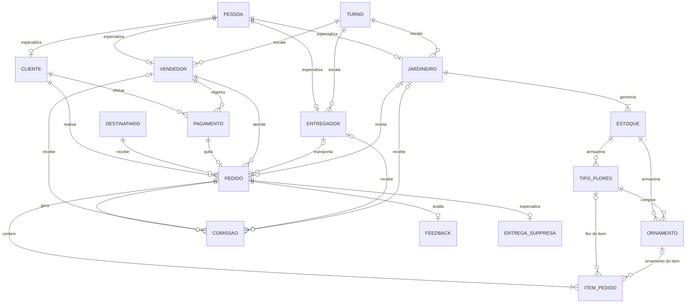

# Modelo Conceitual

**UFSC — CIN8003 — Bancos de Dados e Aplicações**  
**Docente:** Moisés Lima Dutra  
**Aluna:** Maria Vithória de Oliveira  
**Cenário:** floricultura

[Diagrama entidade-relacionamento da floricultura](diagrama_mer.pdf)

O diagrama em texto abaixo acompanha o esquema implementado nos scripts. A leitura da cardinalidade fica ao lado de cada entidade: o traço duplo é exatamente um, o círculo é opcional, e o pé de galinha é vários.

## Entidades e atributos

- **Pessoa:** nome, sobrenome, CPF, data de nascimento, telefone, e-mail, endereço e relação (cliente ou funcionário).
- **Cliente:** ligação com a pessoa.
- **Vendedor:** ligação com a pessoa, turno e status (ativo ou inativo).
- **Entregador:** ligação com a pessoa e turno.
- **Jardineiro:** ligação com a pessoa e turno.
- **Turno:** dia (de 1 a 6), horas e período.
- **Estoque:** quantidade de sementes e jardineiro responsável.
- **Tipo de flor:** nome, cor, tamanho, quantidade e estoque.
- **Ornamento:** cor, tamanho, fitas, poda, quantidade, estoque e flor a que pertence.
- **Destinatário:** nome, endereço e telefone.
- **Pagamento:** valor, tipo (débito ou crédito), parcelamento, cliente e vendedor.
- **Pedido:** data, status, modalidade (retirada, entrega ou surpresa), cliente, destinatário, pagamento, vendedor, entregador e jardineiro.
- **Item do pedido:** pedido, flor ou ornamento, e quantidade.
- **Comissão:** valor, pedido e exatamente um profissional (vendedor, entregador ou jardineiro).
- **Feedback:** nota, descrição e pedido.
- **Entrega surpresa:** tipo da ocasião, local, sigilo e pedido.

## Relacionamentos

- Uma pessoa tem no máximo um cadastro em cada papel. Cliente e funcionário são pessoas.
- Cada funcionário tem um turno. Um turno pode reunir vários funcionários.
- Cada estoque tem um jardineiro. Um jardineiro gerencia pelo menos um estoque.
- Flores e ornamentos ficam em um estoque. O ornamento pertence a uma flor, e a flor pode ter vários ornamentos.
- Um cliente faz vários pedidos e pode ter vários pagamentos. Cada pedido tem um cliente, um destinatário e um pagamento.
- O vendedor atende vários pedidos. Entregador e jardineiro são opcionais no pedido: o entregador não existe na retirada no local.
- O pedido tem um ou mais itens. Cada item é uma flor ou um ornamento, nunca os dois ao mesmo tempo.
- Cada trabalho realizado gera uma comissão para o profissional daquele pedido.
- O feedback é opcional, no máximo um por pedido, e só depois da entrega.
- A entrega surpresa é opcional e, quando existe, é única para o pedido.
